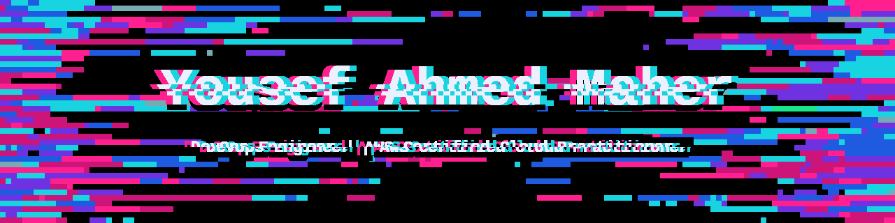
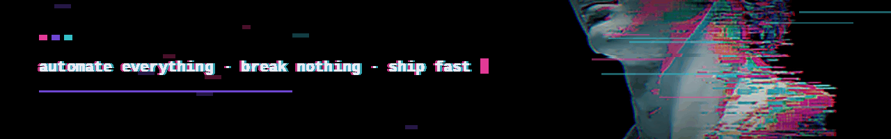

<div align="center">
  
</div>

<div align="center">
  
</div>

<br>

<div align="center">

**DevOps Engineer · AWS Certified Cloud Practitioner · Open Source Contributor · Elswedy Polytechnic · Egypt**


[](https://www.linkedin.com/in/yousef-ahmed-maher-amin-272275279)
[](https://www.youtube.com/@JooAhmeddev001)

</div>


## ▓▒░ About

```yaml
name:       Yousef Ahmed Maher
role:       DevOps Engineer
certified:  AWS Certified Cloud Practitioner (CLF-C02)
education:  Elswedy Polytechnic · Egypt
focus:      [Linux, Containers, CI/CD, AWS, Cloud, IaC, NestJS, Kafka]
learning:   [Ansible, Advanced Kubernetes]
open_source: true
motto:      "Automate everything. Break nothing. Ship fast."
```


## ▓▒░ Certifications

🏅 **AWS Certified Cloud Practitioner (CLF-C02)**


## ▓▒░ Open Source

🌱 Active open source contributor — collaborating on real-world repos, fixing issues, and improving docs/CI pipelines.
Check my pinned repositories below for contributions and personal projects.


## ▓▒░ Tech Stack

<div align="center">
  <a href="#"></a>
</div>


## ▓▒░ GitHub Stats

<div align="center">
  
</div>

<br>

<div align="center">
  <sub><code>automate everything · break nothing · ship fast</code></sub>
</div>


